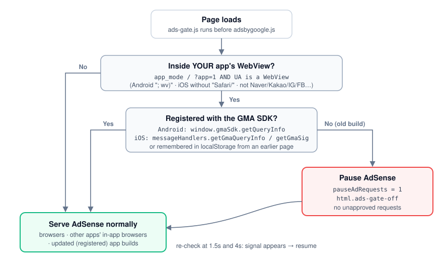

# capacitor-adsense-webview

**Fix "Ads in unapproved WebViews" (AdSense Policy Center) for Capacitor apps — Android + iOS + a safe rollout for users still on the old build.**

[한국어 README](./README.ko.md)



If your Capacitor (or any WebView) app loads your website and that website runs AdSense, every ad request from inside the app is an **unapproved WebView request** unless the WebView is registered with the Google Mobile Ads SDK. Google started enforcing this hard: Policy Center fills with violations and mobile CPC collapses while ads *appear* to keep working.

This repo is the complete fix we use in production at [ETF Shopping](https://etfshopping.com) (a Korean/Japanese ETF research site with a Capacitor app on both stores), including the parts Google's docs don't cover: the website-side gate for users who haven't updated, the signals that actually tell you a WebView is registered, and the traps we fell into.

## What it looks like when it hits

There is no outage and no error. That is what makes it dangerous:

| Signal | What you see |
|---|---|
| Policy Center | URLs listed as "Ads in unapproved WebViews", status "Ad serving limited" |
| Ad requests / impressions | roughly unchanged |
| Mobile clicks | unchanged, sometimes *higher* |
| Mobile CPC | drops sharply, often to a small fraction of normal |
| Desktop | unaffected |

Ads keep serving; only cheap demand is allowed to bid on the restricted inventory. If you only watch impressions or clicks you won't notice. Split your AdSense report by **Platform** and watch mobile CPC.

**Check your own numbers:** AdSense → Reports → breakdown by Platform → compare mobile CPC for the week before the first Policy Center entry with the week after.

## The fix in three parts

### 1. Android — register the WebView

[`android/MainActivity.java`](android/MainActivity.java) · [`android/AndroidManifest.snippet.xml`](android/AndroidManifest.snippet.xml) · [`android/build.gradle.snippet`](android/build.gradle.snippet)

```java
CookieManager.getInstance().setAcceptThirdPartyCookies(webView, true);
webView.getSettings().setJavaScriptEnabled(true);
webView.getSettings().setDomStorageEnabled(true);
webView.getSettings().setMediaPlaybackRequiresUserGesture(false);
MobileAds.registerWebView(webView);
```

plus `INTEGRATION_MANAGER = webview` in the manifest (without it the call throws at startup).

### 2. iOS — register the WKWebView

[`ios/MainViewController.swift`](ios/MainViewController.swift) · [`ios/Info.plist.snippet`](ios/Info.plist.snippet)

```swift
override open func capacitorDidLoad() {
    super.capacitorDidLoad()
    if let wv = webView { MobileAds.shared.register(wv) }
}
```

plus inline-playback config and `GADIntegrationManager = webview` in Info.plist.

Verify both with Google's test page inside the app: `https://google.github.io/webview-ads/test` → "WebView connected to GMA SDK".

### 3. Website — stop requests from old app builds

[`web/ads-gate.js`](web/ads-gate.js) (inline in `<head>`, before `adsbygoogle.js`) · [`web/ads-gate.css`](web/ads-gate.css) · [`web/app-mode.js`](web/app-mode.js) · [`web/appWebview.ts`](web/appWebview.ts)

Shipping new app builds doesn't stop the violations: users on the old build keep making unapproved requests for weeks. The gate detects "inside *our* app's WebView, but not registered" and pauses AdSense there:

```js
(window.adsbygoogle = window.adsbygoogle || []).pauseAdRequests = 1;
document.documentElement.classList.add("ads-gate-off");
```

"Registered" is detected from the signals the GMA SDK injects itself — `window.gmaSdk.getQueryInfo` on Android, `webkit.messageHandlers.getGmaQueryInfo` / `getGmaSig` on iOS — so the moment a user updates, ads come back without any further deploy. Everything else (browsers, other apps' in-app browsers) is untouched.

## Read these before you ship

- [docs/pitfalls.md](docs/pitfalls.md) — the eight things that actually bit us (editing a Swift file that isn't compiled; a `WKUserScript` marker Capacitor silently drops; shared links that look like the app; late-attaching bridges; hidden `<ins>` stealing `push()` ...)
- [docs/rollout.md](docs/rollout.md) — the order of operations, when to request the policy review, and what recovery looks like in the reports

## Requirements

- Capacitor 6+ (we run 8), Android `play-services-ads` 24.x, iOS Google Mobile Ads SDK 12.x (Swift Package Manager)
- An AdMob app ID per platform (free; you don't need to serve AdMob ads)
- Your app loads the site with a marker query (we use `?app=1`) so the web can tell it's the app

## Not covered

- Cordova/Ionic-without-Capacitor: the native calls are the same, the hooks differ
- AdMob native ad units: this repo is only about AdSense web ads inside a WebView
- Consent (GDPR/UMP): unchanged by this; keep whatever you already do

## About

Built and used by [ETF Shopping](https://etfshopping.com) · [ETFショッピング](https://ja.etfshopping.com) — ETF, stock and dividend research for Korean and Japanese investors. Made by Shoppers Lab.

MIT License.
